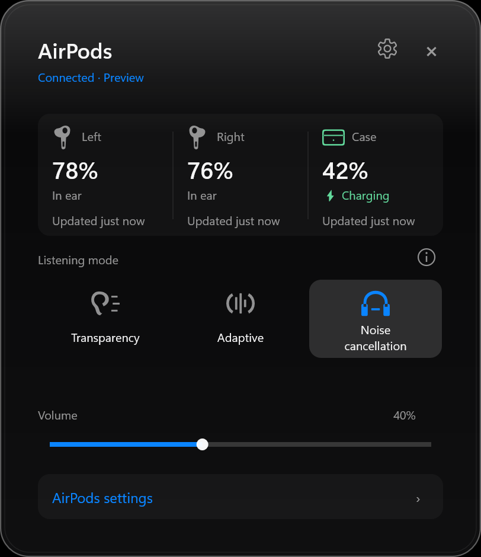
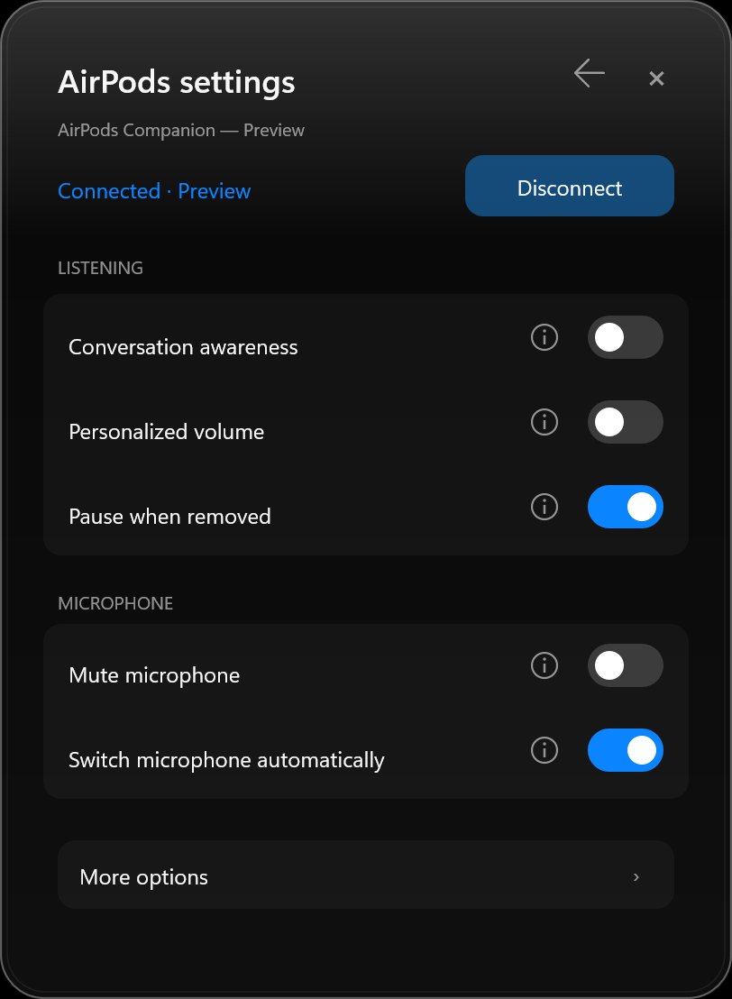

<div align="center">

# Podglow

### Your AirPods, within reach on Windows.

Battery readings, listening modes and audio controls in a compact tray widget.

**Experimental alpha · Windows x64 · GPL-3.0**

[Download alpha](https://github.com/WendelinProfiler/podglow/releases/tag/v0.1.3-alpha.1) · [Preview](#preview) · [Build](#try-the-interface) · [Development](docs/DEVELOPMENT.md) · [Credits](CREDITS.md)

</div>

Built on [WPods](https://github.com/FPNDev/wpods), with a shared native interface for the Windows notification area and an optional Island integration.

> **Experimental download:** [0.1.3 alpha](https://github.com/WendelinProfiler/podglow/releases/tag/v0.1.3-alpha.1) includes the widget, matching host, service and runtime. The package has been built and checked locally. Installation, removal, recovery and operation on clean or different Windows hardware have not been tested. Read the [release notes](RELEASE-NOTES.md) before installing.

## Preview

<table>
<tr><th>Everyday controls</th><th>Settings when you need them</th></tr>
<tr>
<td width="50%"></td>
<td width="50%"></td>
</tr>
</table>

Actual app renders with labelled sample data. The public build excludes the private prototype's Apple artwork and extracted glyphs. [View the screenshots](docs/SCREENSHOTS.md).

## What it does

| Control | Behavior |
| --- | --- |
| Battery | Separate left, right and case readings, charging status and measurement age. Cached values stay marked as last seen. |
| Listening modes | Transparency, Adaptive and Noise Cancellation on supported AirPods. |
| Audio | Volume, microphone mute and automatic microphone selection. Scroll anywhere over the widget to adjust volume; your Windows/device scroll direction is preserved. |
| Connection | Connect or disconnect the selected AirPods from the widget. |
| Updates | Daily checks, release notes and a verified download after confirmation. [How updates work](docs/UPDATES.md). |
| Settings | Additional controls behind the gear button, with help beside unfamiliar options. |

Advanced controls use the matching modified WPods host. Availability depends on the AirPods model and connection state.

The standalone widget opens from the Windows notification area. Windhawk, a taskbar replacement and Lenovo software are optional. Both hosts use the same native presentation.

## Install the alpha

Download `Podglow-Setup.exe` and `SHA256SUMS.txt` from the [prerelease](https://github.com/WendelinProfiler/podglow/releases/tag/v0.1.3-alpha.1). Setup provides optional sign-in startup and Bluetooth consent. It preserves an existing installation owned by another WPods app by refusing to replace it. Our app and installer are unsigned.

See the [installation and recovery notes](RELEASE-NOTES.md). For a UI-only preview, build from source below.

## Try the interface

Requirements: Windows x64, Visual Studio Build Tools with MSVC and the Windows SDK.

```powershell
git clone https://github.com/WendelinProfiler/podglow.git
cd podglow
./scripts/Build-NativeWidget.ps1
out/native-widget/Podglow.exe --preview
```

Preview mode uses sample data and sends no AirPods commands. Building the backend also needs .NET 10. See [development instructions](docs/DEVELOPMENT.md) for host compatibility, startup options and verification.

## Tested so far

The shared native interface has passed local navigation checks, including settings, contextual help and credits. Hardware development has been tested on one Lenovo running Windows 11 x64 with AirPods Pro 3. Other computers, adapters and AirPods models still need testing.

The public host needs its own end-to-end connection, mode and microphone tests. Installer rollback, uninstall, packaged Bluetooth operation, multiple monitors and clean Windows installation remain on the [release checklist](RELEASE-CHECKLIST.md). Driver setup may require a user-approved restart on a new computer; the widget never restarts Windows automatically.

Case readings refresh when a valid report arrives. Opening a case alone does not make a cached reading current.

## Contributing

Useful reports include your Windows version, AirPods model, Bluetooth adapter and steps to reproduce the problem. Say whether you used preview mode or the matching modified host. Remove device addresses and account details from logs before sharing them.

Start with the [release checklist](RELEASE-CHECKLIST.md) for areas that need validation. Please keep upstream copyright notices and component licenses with changes and redistributed builds.

## Credits

**WPods by FPNDev and its contributors provides the Bluetooth engine and AirPods control foundation.** This project adds the shared widget, Windows tray host and companion integration.

Other contributions include [usbip-win2](https://github.com/vadimgrn/usbip-win2), protocol documentation from [stuffz/airpods](https://github.com/stuffz/airpods), and presentation references from [AirPodsDesktop](https://github.com/SpriteOvO/AirPodsDesktop) and [Mac Island & Dock](https://windhawk.net/mods/mac-island-dock).

[Full credits](CREDITS.md) explain what each project contributed. Required dependency notices remain in [licenses/](licenses/).

## License

[GPL-3.0](LICENSE), with component-specific notices. AirPods and Apple are trademarks of Apple Inc. This is an independent experimental project.
