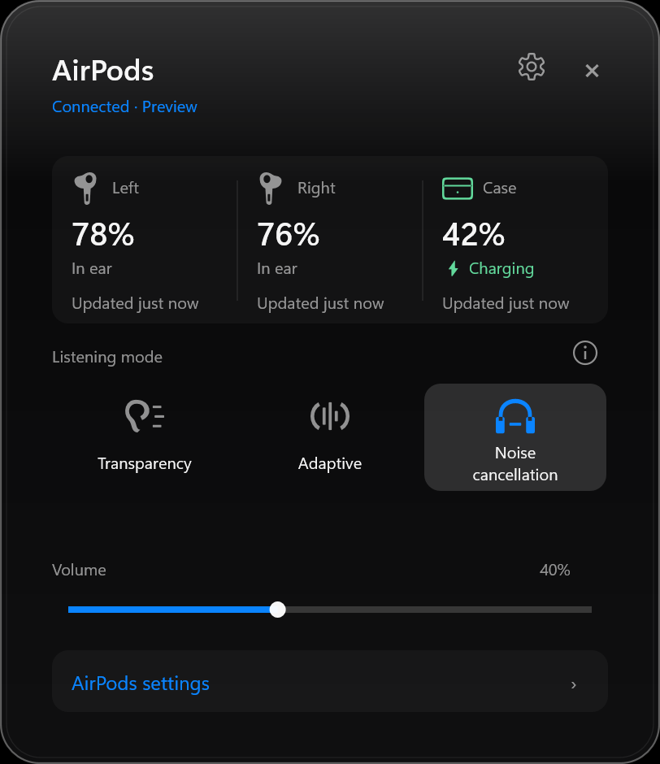
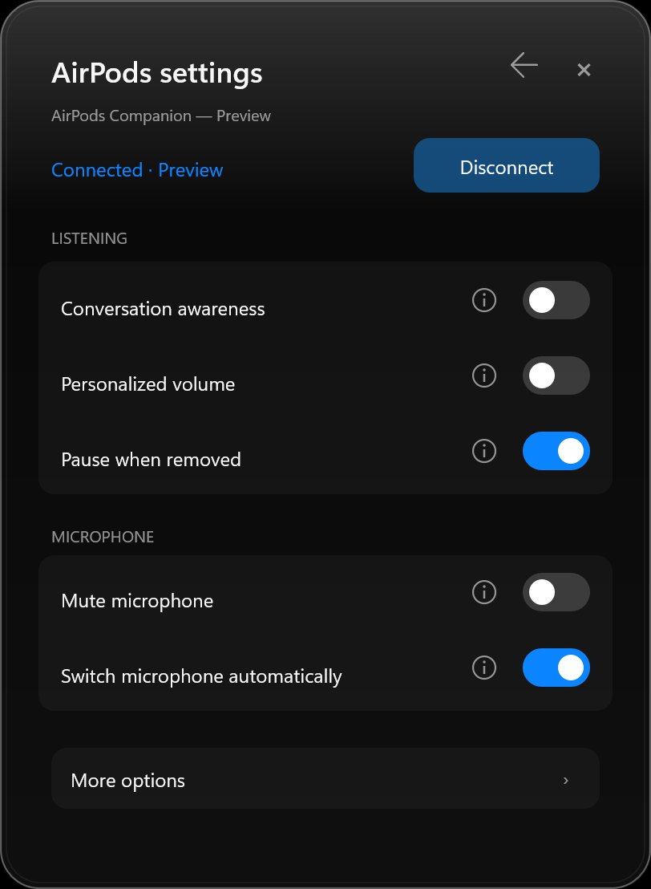

# Screenshots

These images show the actual shared native interface running in preview mode. Battery readings and connection state are sample data. They are not evidence of a tested public installation.

## Everyday controls

Battery readings for each earbud and the case, listening modes and volume stay together in the main panel.

## Settings

Additional controls live behind the settings button, keeping the main panel compact.

The main preview shows Podglow's own vector icons. The public build excludes the private prototype's Apple artwork and extracted glyphs. Images are rendered from the app's own window; they contain no desktop or personal account information.
